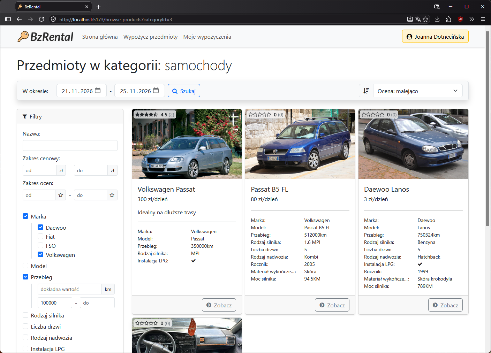
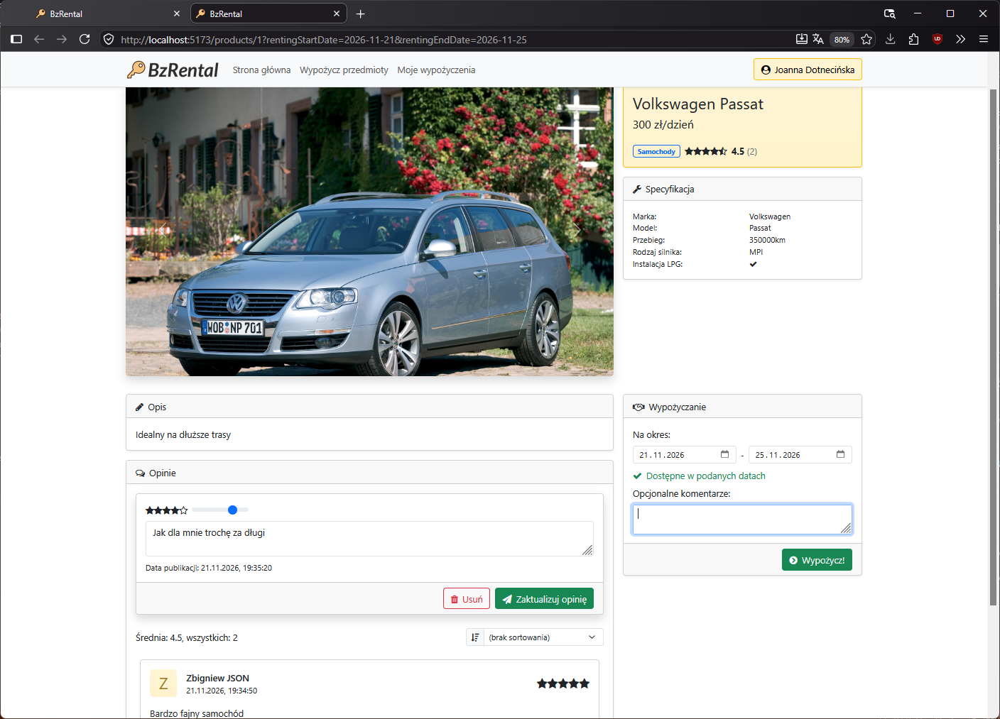
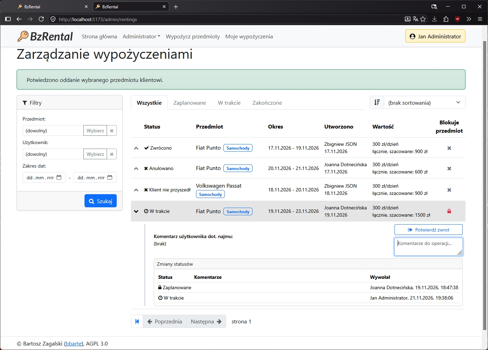
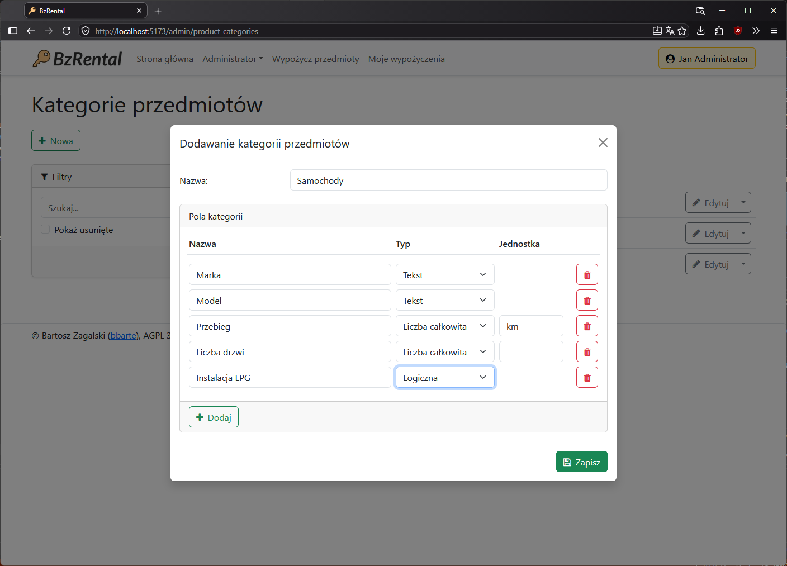

<p style="text-align:center;">
  
</p>

<h3 style="text-align:center;">
    &copy; Bartosz Zagalski 2026, licencja AGPL 3.0
</h3>

Prosty, konfigurowalny system obsługi wypożyczalni przedmiotów, stworzony w ramach projektu szkolnego.

Aplikacja składa się z frontendu napisanego w React'cie (typescript, react-router-dom, bootstrap, axios) oraz API w ASP.NET Core.

Kilka słów więcej o API:

- dostęp do bazy danych (SQL Server) poprzez EF Core,
- architektura warstwowa, z wydzieloną domeną i dependency injection,
- walidacja zrealizowana poprzez Fluent Validations,
- dokumentacja API za pomocą biblioteki ReDoc,
- całość stosuje Result Pattern i jednocześnie unika rzucania wyjątków

> [!WARNING]
> Ze względu na to, że projekt ten powstał w ramach zadania szkolnego, nie nadaje się on do zastosowań produkcyjnych, ze względu na uproszczenia w implementacji zabezpieczeń, wynikające z ograniczonej ilości czasu. W szczególności chodzi tutaj o sposób przechowywania tokenów JWT po stronie frontendu. Warstwa API została natomiast zaimplementowana z uzwględnieniem dobrych praktyk bezpieczeństwa.

## II. Zdjęcia









## III. Kompilacja

### Kompilacja i uruchomienie API

Należy skompilować rozwiązanie API, znajdujące się w `src/Backend/BzRental/*`. Przed uruchomieniem, należy zdefiniować connection string do bazy danych oraz klucz JWT, najlepiej w "User Secrets" Visual Studio. Przykładowa zawartość powyższego pliku:

```json
{
  "ConnectionStrings:DefaultConnection": "Server=xx\\SQLEXPRESS;Database=BzRental;User Id=xx;Password=xx;MultipleActiveResultSets=true;TrustServerCertificate=True;",
  "Jwt:Key": "xx"
}
```

Następnie, w konsoli menadżera pakietów NuGet Visual Studio wykonujemy komendę `Update-Database`, aby postawić bazę danych projektu.

Domyślny adres API: https://localhost:7194/api/

Domyślny adres dokumentacji API: https://localhost:7194/api-docs/index.html

### Uruchomienie frontendu

W folderze projektu React'owego (`src/Frontend/bzrental-front`) uruchamiamy konsolę i wykonujemy komendę `npm install`, aby pobrać wszystkie zależności.

Następnie uruchamiany `npm run dev`. Strona domyślnie znajduje się pod adresem [http://localhost:5173/](http://localhost:5173/)

Domyślny login administratora: `admin` `admin`